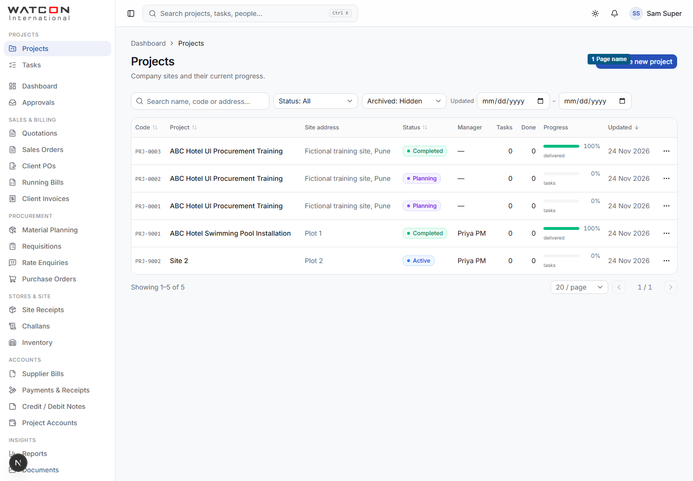
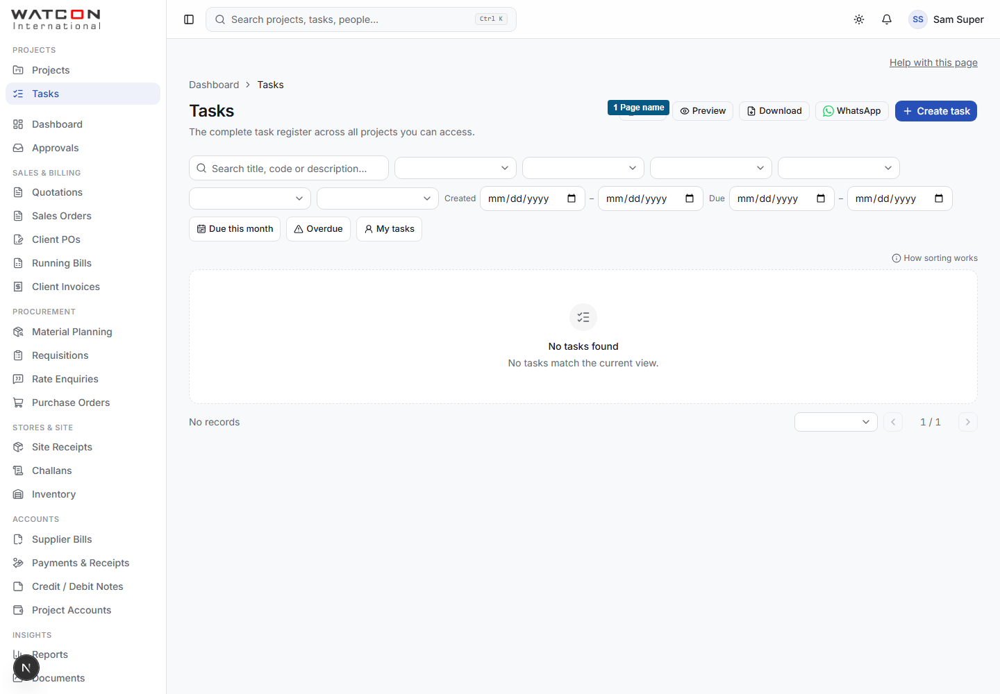
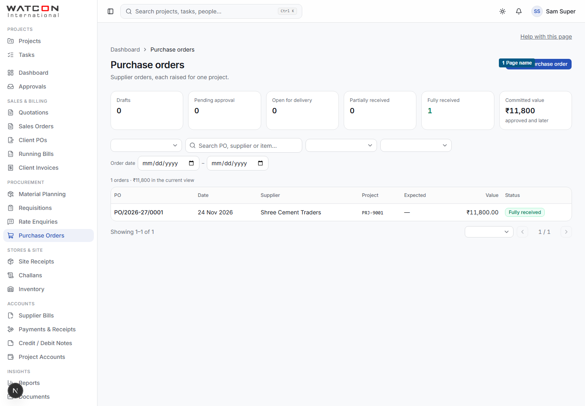
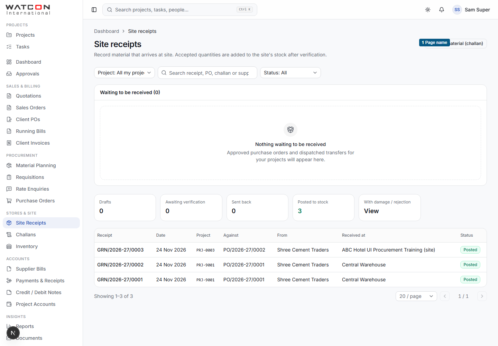
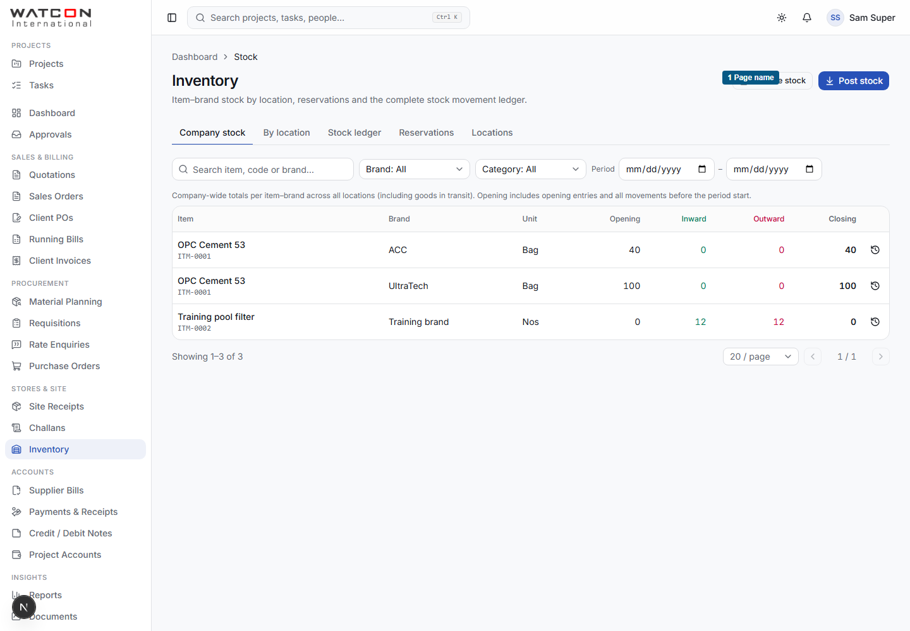
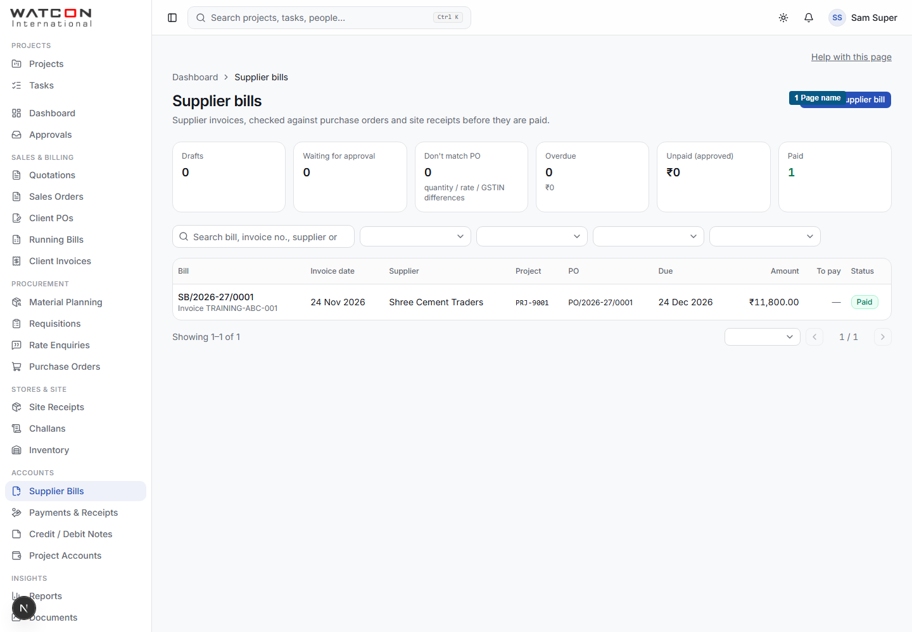
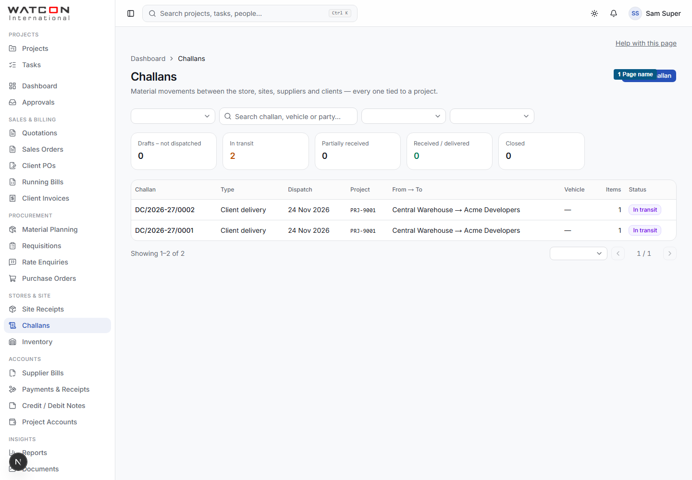
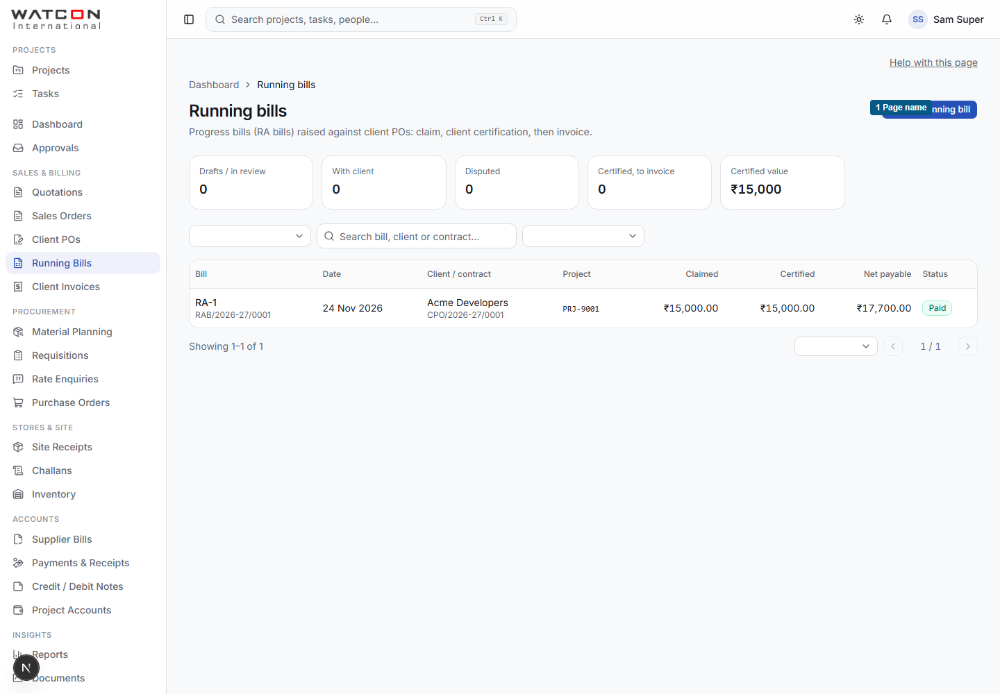
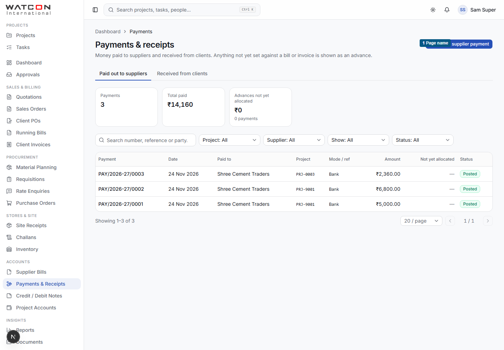
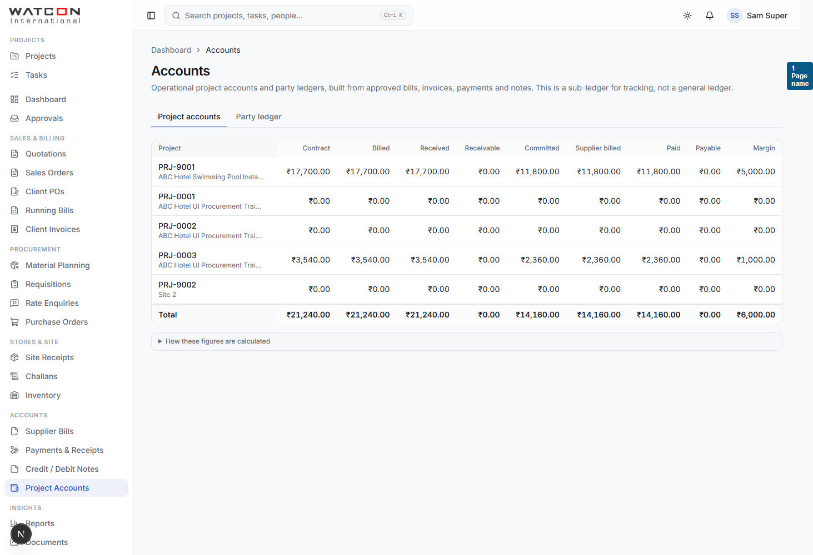

# WATCON Enterprise — Complete User Guide

Edition 27 November 2026. Read this guide with your supervisor during training. Menu visibility depends on your permissions. Screenshots marked local contain fictional training data. The audit reports identify tested and untested operations. This guide does not certify production balances.

## Contents

1. Getting Started
2. Dashboard
3. Projects
4. Tasks
5. Departments
6. Team Members
7. Items
8. Brands
9. Suppliers
10. Clients
11. Material Planning
12. Requisitions
13. Rate Enquiries
14. Purchase Orders
15. Site receipts
16. Inventory
17. Supplier Bills
18. Quotations
19. Client POs
20. Sales Orders
21. Challans
22. Running Bills
23. Client Invoices
24. Payments & Receipts
25. Credit / Debit Notes
26. Project Accounts
27. Reports
28. Documents
29. Inbox
30. Administration
31. Complete Business Workflow
32. Super Admin
33. Admin
34. Project Manager
35. Site Engineer
36. Purchase Department
37. Sales Department
38. Store or Inventory Manager
39. Accounts Department
40. Normal Employee
41. Business Terms Glossary
42. Frequently Asked Questions
43. Troubleshooting

## Getting Started

Learn how to sign in and use the menu.

### Before you begin

Ask your manager for your work login and the modules you should use. The screen can hide actions your account cannot perform.

### Sign in

1. Open the WATCON application.

2. Enter Email or username and Password.

3. Click Sign in.

4. If asked, enter Current password, New password and Confirm new password. Click Update password.

### Find your work

Use the left menu on a desktop. On a phone, use the navigation button at the top. Open Tasks for your assigned work. Open a record to see its details.

### Save safely

Check the project, party, item, brand, quantity and date before saving. A draft changes totals only once it is finalized, confirmed or issued. Wait for confirmation before trying again.

### Sign out

Open your account menu and choose Sign out. Do this on shared computers.

### Verification note

This guide explains the available screens. Use only actions your account allows. Ask your supervisor when a business rule is unclear. Training screenshots use fictional records.

### How to get a manual

Help & User Guide is available to Super Admin in Administration → Help & guide. Other employees should ask their supervisor or Super Admin for a copy of this manual. Help pages and downloads are restricted to Super Admin.

## Dashboard

See the work and totals you are allowed to see.

### What is this module?

See the work and totals you are allowed to see.

### Why should I use it?

See the work and totals you are allowed to see.

### Who should use it?

All employees. Your granted permissions decide which actions you can use.

### When should I use it?

Use this module when its step in the job is ready. Check the source document and actual material or payment first.

### How do I open it?

Open Dashboard from the left menu. Address: /dashboard.

### How do I add or operate a record?

1. Open Dashboard.

2. Use the project and task links to open the matching lists.

3. Check deadlines and pending work.

### Important fields

Use the displayed project, date, reference, status and search filters where available. Read the help beside each field. This page may be a register rather than a creation form.

### How do I save?

Use the save or creation button described above. Read validation messages, correct the named field and try again. On a viewing or report page there is nothing to save.

### How do I view or edit?

Open the record from its list. Use Edit only when it is offered. Final records cannot be edited directly. Admins use Amend, Cancel or Reverse on the record (with a reason). A confirmed Sales Order is the exception: only the Super Admin approves its amendments.

### How do I print or download?

Use a PDF, Print or export action only where the page displays one. Documents has authorized attachment downloads. Not every register has its own PDF. See the PDF support list in this guide.

### What happens after saving?

Read the saved status. Draft records still need the next action described above. A draft changes nothing until you finalize, confirm or issue it.

### Does it affect stock or accounts?

Viewing this page does not post stock or money. Totals follow your permissions.

### What should I do next?

Open the record that needs attention.

### Common mistakes to avoid

Do not use another project, brand or party just to make a form save. Do not enter the same physical movement twice. Ask your supervisor before cancelling or reversing a posted record.

## Projects

Keep one site or job and its linked work together.

### What is this module?

Keep one site or job and its linked work together.

### Why should I use it?

Keep one site or job and its linked work together.

### Who should use it?

Project Manager or Admin. Your granted permissions decide which actions you can use.

### When should I use it?

Use this module when its step in the job is ready. Check the source document and actual material or payment first.

### How do I open it?

Open Projects from the left menu. Address: /projects.

### How do I add or operate a record?

1. Click Create new project.

2. Enter Site / project name, Site address and Project description.

3. Choose Project manager and Project members.

4. Set dates, Priority and Status.

5. Click Create project.

6. Open the saved project to view work and status history.

### Important fields

Site / project name: A short name employees recognize.

Project code: The generated reference for this job.

Site address: The physical work location.

Project description: What the job covers.

Start date

Expected completion

Priority: How urgently work needs attention.

Status: The current stage of the record.

Project manager: The person responsible for the job.

Project members: People who need to work on this job.

### How do I save?

Use the save or creation button described above. Read validation messages, correct the named field and try again. On a viewing or report page there is nothing to save.

### How do I view or edit?

Open the record from its list. Use Edit only when it is offered. Final records cannot be edited directly. Admins use Amend, Cancel or Reverse on the record (with a reason). A confirmed Sales Order is the exception: only the Super Admin approves its amendments.

### How do I print or download?

Use a PDF, Print or export action only where the page displays one. Documents has authorized attachment downloads. Not every register has its own PDF. See the PDF support list in this guide.

### What happens after saving?

Read the saved status. Draft records still need the next action described above. A draft changes nothing until you finalize, confirm or issue it.

### Does it affect stock or accounts?

Saving a project creates a job record. Approved orders and deliveries can later change its status and progress automatically.

### What should I do next?

Create tasks and the required orders.

### Common mistakes to avoid

Do not use another project, brand or party just to make a form save. Do not enter the same physical movement twice. Ask your supervisor before cancelling or reversing a posted record.

The numbered highlight identifies the page name. The image shows the actual local application with fictional records.

## Tasks

Tell people what work they must do and track progress.

### What is this module?

Tell people what work they must do and track progress.

### Why should I use it?

Tell people what work they must do and track progress.

### Who should use it?

Managers and assigned employees. Your granted permissions decide which actions you can use.

### When should I use it?

Use this module when its step in the job is ready. Check the source document and actual material or payment first.

### How do I open it?

Open Tasks from the left menu. Address: /tasks.

### How do I add or operate a record?

1. Click Create task.

2. Choose the project, departments and team members.

3. Choose an accountable owner who is also assigned.

4. Enter the title, dates and priority.

5. Save the task.

6. Open it and use Update progress or add a comment.

### Important fields

Task title

Task code

Project: The job or site this record belongs to.

Task description

Departments

Team members

Accountable owner

Start date

Due date

Priority: How urgently work needs attention.

Status: The current stage of the record.

Progress (%)

### How do I save?

Use the save or creation button described above. Read validation messages, correct the named field and try again. On a viewing or report page there is nothing to save.

### How do I view or edit?

Open the record from its list. Use Edit only when it is offered. Final records cannot be edited directly. Admins use Amend, Cancel or Reverse on the record (with a reason). A confirmed Sales Order is the exception: only the Super Admin approves its amendments.

### How do I print or download?

Use a PDF, Print or export action only where the page displays one. Documents has authorized attachment downloads. Not every register has its own PDF. See the PDF support list in this guide.

### What happens after saving?

Read the saved status. Draft records still need the next action described above. A draft changes nothing until you finalize, confirm or issue it.

### Does it affect stock or accounts?

Tasks do not post stock or payments. Completed means 100 percent. Reopening requires progress below 100 percent.

### What should I do next?

Review the project task list.

### Common mistakes to avoid

Do not use another project, brand or party just to make a form save. Do not enter the same physical movement twice. Ask your supervisor before cancelling or reversing a posted record.

The numbered highlight identifies the page name. The image shows the actual local application with fictional records.

## Departments

Group employees by the work they do.

### What is this module?

Group employees by the work they do.

### Why should I use it?

Group employees by the work they do.

### Who should use it?

Admin. Your granted permissions decide which actions you can use.

### When should I use it?

Use this module when its step in the job is ready. Check the source document and actual material or payment first.

### How do I open it?

Open Departments from the left menu. Address: /departments.

### How do I add or operate a record?

1. Click Add department.

2. Enter the department details.

3. Click Create department.

4. Open the department to view its people and tasks.

### Important fields

Department code

Department name

Description

Department head

Status: The current stage of the record.

### How do I save?

Use the save or creation button described above. Read validation messages, correct the named field and try again. On a viewing or report page there is nothing to save.

### How do I view or edit?

Open the record from its list. Use Edit only when it is offered. Final records cannot be edited directly. Admins use Amend, Cancel or Reverse on the record (with a reason). A confirmed Sales Order is the exception: only the Super Admin approves its amendments.

### How do I print or download?

Use a PDF, Print or export action only where the page displays one. Documents has authorized attachment downloads. Not every register has its own PDF. See the PDF support list in this guide.

### What happens after saving?

Read the saved status. Draft records still need the next action described above. A draft changes nothing until you finalize, confirm or issue it.

### Does it affect stock or accounts?

No stock or account entry is created. A name must be unique.

### What should I do next?

Assign employees to the department.

### Common mistakes to avoid

Do not use another project, brand or party just to make a form save. Do not enter the same physical movement twice. Ask your supervisor before cancelling or reversing a posted record.

## Team Members

Create employee access and map people to departments.

### What is this module?

Create employee access and map people to departments.

### Why should I use it?

Create employee access and map people to departments.

### Who should use it?

Admin within permission limits or Super Admin. Your granted permissions decide which actions you can use.

### When should I use it?

Use this module when its step in the job is ready. Check the source document and actual material or payment first.

### How do I open it?

Open Team Members from the left menu. Address: /team-members.

### How do I add or operate a record?

1. Open Team Members.

2. Click Add member.

3. Enter the employee details and username.

4. Choose the role and primary department.

5. Choose additional departments if needed.

6. Enter a temporary password.

7. Click Create member.

### Important fields

Full name

Employee ID

Designation

Joining date

Phone number

WhatsApp number

Primary department

Additional departments

Email

Username

Role

Temporary password

### How do I save?

Use the save or creation button described above. Read validation messages, correct the named field and try again. On a viewing or report page there is nothing to save.

### How do I view or edit?

Open the record from its list. Use Edit only when it is offered. Final records cannot be edited directly. Admins use Amend, Cancel or Reverse on the record (with a reason). A confirmed Sales Order is the exception: only the Super Admin approves its amendments.

### How do I print or download?

Use a PDF, Print or export action only where the page displays one. Documents has authorized attachment downloads. Not every register has its own PDF. See the PDF support list in this guide.

### What happens after saving?

Read the saved status. Draft records still need the next action described above. A draft changes nothing until you finalize, confirm or issue it.

### Does it affect stock or accounts?

No stock or account entry is created. New members must change their temporary password. Deactivation keeps history and revokes sessions.

### What should I do next?

Ask the employee to sign in and change their password.

### Common mistakes to avoid

Do not use another project, brand or party just to make a form save. Do not enter the same physical movement twice. Ask your supervisor before cancelling or reversing a posted record.

## Items

Maintain the materials the company buys or supplies.

### What is this module?

Maintain the materials the company buys or supplies.

### Why should I use it?

Maintain the materials the company buys or supplies.

### Who should use it?

Storekeeper or authorized master-data operator. Your granted permissions decide which actions you can use.

### When should I use it?

Use this module when its step in the job is ready. Check the source document and actual material or payment first.

### How do I open it?

Open Items from the left menu. Address: /items.

### How do I add or operate a record?

1. Open Items.

2. Open the add item form.

3. Enter the item name and Unit.

4. Enter other needed details and save.

5. Open the item to link its brands.

### Important fields

Item code

Unit: How the material is counted, such as Bag or Nos.

Item name

Category

Description

Status: The current stage of the record.

### How do I save?

Use the save or creation button described above. Read validation messages, correct the named field and try again. On a viewing or report page there is nothing to save.

### How do I view or edit?

Open the record from its list. Use Edit only when it is offered. Final records cannot be edited directly. Admins use Amend, Cancel or Reverse on the record (with a reason). A confirmed Sales Order is the exception: only the Super Admin approves its amendments.

### How do I print or download?

Use a PDF, Print or export action only where the page displays one. Documents has authorized attachment downloads. Not every register has its own PDF. See the PDF support list in this guide.

### What happens after saving?

Read the saved status. Draft records still need the next action described above. A draft changes nothing until you finalize, confirm or issue it.

### Does it affect stock or accounts?

Creating an item does not receive material. Stock belongs to each item and brand combination.

### What should I do next?

Link the correct brand and record stock through an authorized movement.

### Common mistakes to avoid

Do not use another project, brand or party just to make a form save. Do not enter the same physical movement twice. Ask your supervisor before cancelling or reversing a posted record.

## Brands

Keep brand names consistent across materials.

### What is this module?

Keep brand names consistent across materials.

### Why should I use it?

Keep brand names consistent across materials.

### Who should use it?

Authorized master-data operator. Your granted permissions decide which actions you can use.

### When should I use it?

Use this module when its step in the job is ready. Check the source document and actual material or payment first.

### How do I open it?

Open Brands from the left menu. Address: /brands.

### How do I add or operate a record?

1. Open Brands.

2. Open the add brand form.

3. Enter a unique brand name.

4. Save the brand.

5. Open the relevant item to link it.

### Important fields

Brand code

Brand name

Description

Status: The current stage of the record.

### How do I save?

Use the save or creation button described above. Read validation messages, correct the named field and try again. On a viewing or report page there is nothing to save.

### How do I view or edit?

Open the record from its list. Use Edit only when it is offered. Final records cannot be edited directly. Admins use Amend, Cancel or Reverse on the record (with a reason). A confirmed Sales Order is the exception: only the Super Admin approves its amendments.

### How do I print or download?

Use a PDF, Print or export action only where the page displays one. Documents has authorized attachment downloads. Not every register has its own PDF. See the PDF support list in this guide.

### What happens after saving?

Read the saved status. Draft records still need the next action described above. A draft changes nothing until you finalize, confirm or issue it.

### Does it affect stock or accounts?

No stock is created by a brand name. Case-insensitive duplicate names are rejected.

### What should I do next?

Use the item and brand combination on documents.

### Common mistakes to avoid

Do not use another project, brand or party just to make a form save. Do not enter the same physical movement twice. Ask your supervisor before cancelling or reversing a posted record.

## Suppliers

Keep the details of people or companies we buy from.

### What is this module?

Keep the details of people or companies we buy from.

### Why should I use it?

Keep the details of people or companies we buy from.

### Who should use it?

Purchase Team and Accounts Team. Your granted permissions decide which actions you can use.

### When should I use it?

Use this module when its step in the job is ready. Check the source document and actual material or payment first.

### How do I open it?

Open Suppliers from the left menu. Address: /parties?type=supplier.

### How do I add or operate a record?

1. Open Suppliers.

2. Click Add supplier.

3. Enter the name and contact details.

4. Keep the supplier option selected.

5. Enter address, tax details and payment terms if needed.

6. Save the record.

### Important fields

Name

Legal / registered name: The name printed on official tax and registration records.

Code: The short reference used to find this record.

Type: Choose whether this party is a client, supplier or both.

GSTIN: The party’s tax registration number. Copy it from its official records.

PAN: The party’s permanent tax account number.

State (place of supply): The state used to decide the tax treatment. Ask Accounts if unsure.

TDS section: The tax-deduction category selected by Accounts.

TDS rate %: The percentage Accounts must withhold as TDS.

Contact person

Phone

Email

WhatsApp

Address

City

PIN code

Payment terms (days): The agreed number of days before payment is due.

Credit limit (₹): The permitted amount of credit agreed with this party.

Bank

Account number: The bank account to pay or receive money through. Check it independently.

IFSC: The bank branch code used for a bank transfer.

Status: The current stage of the record.

Notes

### How do I save?

Click Create party. Correct any field named in a validation message. Wait for the saved record and check its status.

### How do I view or edit?

Open the record from its list. Use Edit only when it is offered. Final records cannot be edited directly. Admins use Amend, Cancel or Reverse on the record (with a reason). A confirmed Sales Order is the exception: only the Super Admin approves its amendments.

### How do I print or download?

Use a PDF, Print or export action only where the page displays one. Documents has authorized attachment downloads. Not every register has its own PDF. See the PDF support list in this guide.

### What happens after saving?

Read the saved status. Draft records still need the next action described above. A draft changes nothing until you finalize, confirm or issue it.

### Does it affect stock or accounts?

A supplier profile creates no payable. Approved supplier bills create amounts to pay.

### What should I do next?

Create a Rate Enquiry or Purchase Order.

### Common mistakes to avoid

Do not use another project, brand or party just to make a form save. Do not enter the same physical movement twice. Ask your supervisor before cancelling or reversing a posted record.

## Clients

Keep the details of people or companies that buy from us.

### What is this module?

Keep the details of people or companies that buy from us.

### Why should I use it?

Keep the details of people or companies that buy from us.

### Who should use it?

Sales operator and Accounts Team. Your granted permissions decide which actions you can use.

### When should I use it?

Use this module when its step in the job is ready. Check the source document and actual material or payment first.

### How do I open it?

Open Clients from the left menu. Address: /parties?type=client.

### How do I add or operate a record?

1. Open Clients.

2. Click Add client.

3. Enter the name and contact details.

4. Keep the client option selected.

5. Enter address and tax details if needed.

6. Save the record.

### Important fields

Name

Legal / registered name: The name printed on official tax and registration records.

Code: The short reference used to find this record.

Type: Choose whether this party is a client, supplier or both.

GSTIN: The party’s tax registration number. Copy it from its official records.

PAN: The party’s permanent tax account number.

State (place of supply): The state used to decide the tax treatment. Ask Accounts if unsure.

TDS section: The tax-deduction category selected by Accounts.

TDS rate %: The percentage Accounts must withhold as TDS.

Contact person

Phone

Email

WhatsApp

Address

City

PIN code

Payment terms (days): The agreed number of days before payment is due.

Credit limit (₹): The permitted amount of credit agreed with this party.

Bank

Account number: The bank account to pay or receive money through. Check it independently.

IFSC: The bank branch code used for a bank transfer.

Status: The current stage of the record.

Notes

### How do I save?

Click Create party. Correct any field named in a validation message. Wait for the saved record and check its status.

### How do I view or edit?

Open the record from its list. Use Edit only when it is offered. Final records cannot be edited directly. Admins use Amend, Cancel or Reverse on the record (with a reason). A confirmed Sales Order is the exception: only the Super Admin approves its amendments.

### How do I print or download?

Use a PDF, Print or export action only where the page displays one. Documents has authorized attachment downloads. Not every register has its own PDF. See the PDF support list in this guide.

### What happens after saving?

Read the saved status. Draft records still need the next action described above. A draft changes nothing until you finalize, confirm or issue it.

### Does it affect stock or accounts?

A client profile creates no receivable. Issued Client Invoices create amounts due.

### What should I do next?

Record a Client PO or prepare a Quotation.

### Common mistakes to avoid

Do not use another project, brand or party just to make a form save. Do not enter the same physical movement twice. Ask your supervisor before cancelling or reversing a posted record.

## Material Planning

Compare project requirements with stock and procurement.

### What is this module?

Compare project requirements with stock and procurement.

### Why should I use it?

Compare project requirements with stock and procurement.

### Who should use it?

Project Manager or Purchase Team. Your granted permissions decide which actions you can use.

### When should I use it?

Use this module when its step in the job is ready. Check the source document and actual material or payment first.

### How do I open it?

Open Material Planning from the left menu. Address: /material-planning.

### How do I add or operate a record?

1. Open Material Planning.

2. Choose the project.

3. Review the requirements, available stock and shortages.

4. Use the available planning actions only for the required shortage.

### Important fields

Use the displayed project, date, reference, status and search filters where available. Read the help beside each field. This page may be a register rather than a creation form.

### How do I save?

Use the save or creation button described above. Read validation messages, correct the named field and try again. On a viewing or report page there is nothing to save.

### How do I view or edit?

Open the record from its list. Use Edit only when it is offered. Final records cannot be edited directly. Admins use Amend, Cancel or Reverse on the record (with a reason). A confirmed Sales Order is the exception: only the Super Admin approves its amendments.

### How do I print or download?

Use a PDF, Print or export action only where the page displays one. Documents has authorized attachment downloads. Not every register has its own PDF. See the PDF support list in this guide.

### What happens after saving?

Read the saved status. Draft records still need the next action described above. A draft changes nothing until you finalize, confirm or issue it.

### Does it affect stock or accounts?

A plan alone does not receive or issue stock. Reservations hold stock for a project.

### What should I do next?

Prepare a Requisition for the shortage.

### Common mistakes to avoid

Do not use another project, brand or party just to make a form save. Do not enter the same physical movement twice. Ask your supervisor before cancelling or reversing a posted record.

## Requisitions

Ask the purchase team to arrange materials.

### What is this module?

Ask the purchase team to arrange materials.

### Why should I use it?

Ask the purchase team to arrange materials.

### Who should use it?

Site Engineer or Project Manager. Your granted permissions decide which actions you can use.

### When should I use it?

Use this module when its step in the job is ready. Check the source document and actual material or payment first.

### How do I open it?

Open Requisitions from the left menu. Address: /purchase-requisitions.

### How do I add or operate a record?

1. Open Requisitions.

2. Click New requisition.

3. Choose the project and required materials.

4. Enter quantities and dates.

5. Save a draft.

6. Press Finalize on the record page — no separate approval is needed.

### Important fields

Use the displayed project, date, reference, status and search filters where available. Read the help beside each field. This page may be a register rather than a creation form.

### How do I save?

Use the save or creation button described above. Read validation messages, correct the named field and try again. On a viewing or report page there is nothing to save.

### How do I view or edit?

Open the record from its list. Use Edit only when it is offered. Final records cannot be edited directly. Admins use Amend, Cancel or Reverse on the record (with a reason). A confirmed Sales Order is the exception: only the Super Admin approves its amendments.

### How do I print or download?

Use a PDF, Print or export action only where the page displays one. Documents has authorized attachment downloads. Not every register has its own PDF. See the PDF support list in this guide.

### What happens after saving?

Read the saved status. Draft records still need the next action described above. A draft changes nothing until you finalize, confirm or issue it.

### Does it affect stock or accounts?

A requisition does not receive stock or create a supplier bill.

### What should I do next?

Once finalized, prepare the Rate Enquiry or Purchase Order.

### Common mistakes to avoid

Do not use another project, brand or party just to make a form save. Do not enter the same physical movement twice. Ask your supervisor before cancelling or reversing a posted record.

## Rate Enquiries

Ask suppliers for prices and compare their offers.

### What is this module?

Ask suppliers for prices and compare their offers.

### Why should I use it?

Ask suppliers for prices and compare their offers.

### Who should use it?

Purchase Team. Your granted permissions decide which actions you can use.

### When should I use it?

Use this module when its step in the job is ready. Check the source document and actual material or payment first.

### How do I open it?

Open Rate Enquiries from the left menu. Address: /rate-enquiries.

### How do I add or operate a record?

1. Open Rate Enquiries.

2. Click New enquiry.

3. Choose the project and suppliers.

4. Add the required item and brand lines.

5. Save the enquiry.

6. Record supplier quotations and compare the rates.

7. Use the award action only after reviewing the chosen offer.

### Important fields

Project: The job or site this record belongs to.

Deliver to

Subject

Quotes needed by

Material needed at site by

Suppliers to ask

Payment terms

Freight terms

Tax terms

Quote valid for (days)

Delivery address

General specifications

### How do I save?

Click Save enquiry. Correct any field named in a validation message. Wait for the saved record and check its status.

### How do I view or edit?

Open the record from its list. Use Edit only when it is offered. Final records cannot be edited directly. Admins use Amend, Cancel or Reverse on the record (with a reason). A confirmed Sales Order is the exception: only the Super Admin approves its amendments.

### How do I print or download?

Open the saved document. Use Preview to check it, Download to save the PDF, or Print to open printing. Where WhatsApp is shown, check the recipient and attach the downloaded PDF before sending. These actions do not approve or post the document.

### What happens after saving?

Read the saved status. Draft records still need the next action described above. A draft changes nothing until you finalize, confirm or issue it.

### Does it affect stock or accounts?

An enquiry and supplier quote do not change stock or create a payable.

### What should I do next?

Review the linked Purchase Order after award.

### Common mistakes to avoid

Do not use another project, brand or party just to make a form save. Do not enter the same physical movement twice. Ask your supervisor before cancelling or reversing a posted record.

## Purchase Orders

Tell a supplier which materials we want to buy.

### What is this module?

Tell a supplier which materials we want to buy.

### Why should I use it?

Tell a supplier which materials we want to buy.

### Who should use it?

Purchase Team. Your granted permissions decide which actions you can use.

### When should I use it?

Use this module when its step in the job is ready. Check the source document and actual material or payment first.

### How do I open it?

Open Purchase Orders from the left menu. Address: /purchase-orders.

### How do I add or operate a record?

1. Open Purchase Orders.

2. Click New purchase order.

3. Select Project and Supplier.

4. Check Deliver to and delivery instructions.

5. Add item and brand lines, quantities, rates and GST.

6. Enter freight and payment terms if needed.

7. Click Create draft PO.

8. Press Save & finalize PO (or Finalize PO on a saved draft) — no approval wait.

9. Share the PDF with the supplier from the PO page.

### Important fields

Project: The job or site this record belongs to.

Supplier: The company we buy from.

Deliver to

Delivery address / instructions

Order date

Expected delivery

Freight / other charges (₹): Extra cost in addition to the material lines.

GST on charges %: Tax rate for freight or other charges.

Payment terms

Advance payable (₹)

Terms & conditions (printed)

Internal remarks (not printed): A note for staff, excluded from the printed PO terms.

### How do I save?

Use the save or creation button described above. Read validation messages, correct the named field and try again. On a viewing or report page there is nothing to save.

### How do I view or edit?

Open the record from its list. Use Edit only when it is offered. Final records cannot be edited directly. Admins use Amend, Cancel or Reverse on the record (with a reason). A confirmed Sales Order is the exception: only the Super Admin approves its amendments.

### How do I print or download?

Open the saved document. Use Preview to check it, Download to save the PDF, or Print to open printing. Where WhatsApp is shown, check the recipient and attach the downloaded PDF before sending. These actions do not approve or post the document.

### What happens after saving?

Read the saved status. Draft records still need the next action described above. A draft changes nothing until you finalize, confirm or issue it.

### Does it affect stock or accounts?

A PO alone does not increase stock. Posted Site Receipts receive accepted material. An approved supplier bill records the payable.

### What should I do next?

Record actual arrival through Site receipts.

### Common mistakes to avoid

Do not use another project, brand or party just to make a form save. Do not enter the same physical movement twice. Ask your supervisor before cancelling or reversing a posted record.

The numbered highlight identifies the page name. The image shows the actual local application with fictional records.

## Site receipts

Record materials that actually arrived and passed checks.

### What is this module?

Record materials that actually arrived and passed checks.

### Why should I use it?

Record materials that actually arrived and passed checks.

### Who should use it?

Site Engineer and Storekeeper. Your granted permissions decide which actions you can use.

### When should I use it?

Use this module when its step in the job is ready. Check the source document and actual material or payment first.

### How do I open it?

Open Site Receipts from the left menu. Address: /site-receipts.

### How do I add or operate a record?

1. Open Site Receipts in the menu.

2. Find the source under Waiting to be received.

3. Open its receipt action.

4. Enter Received, Damaged and Rejected quantities.

5. Check Receipt date and Received by.

6. Save, then add the material photos and the supplier challan on the next screen.

7. Press Confirm receipt — the accepted quantity is added to stock at once.

### Important fields

Received

Rejected

Receipt date

Supplier challan no.

Supplier invoice no.: The reference printed on the supplier invoice.

Vehicle no.

Received by: The person who checked the delivery.

Site location (optional)

Remarks

### How do I save?

Use the save or creation button described above. Read validation messages, correct the named field and try again. On a viewing or report page there is nothing to save.

### How do I view or edit?

Open the record from its list. Use Edit only when it is offered. Final records cannot be edited directly. Admins use Amend, Cancel or Reverse on the record (with a reason). A confirmed Sales Order is the exception: only the Super Admin approves its amendments.

### How do I print or download?

Use a PDF, Print or export action only where the page displays one. Documents has authorized attachment downloads. Not every register has its own PDF. See the PDF support list in this guide.

### What happens after saving?

Read the saved status. Draft records still need the next action described above. A draft changes nothing until you finalize, confirm or issue it.

### Does it affect stock or accounts?

Posting a supplier GRN increases accepted stock at its receiving location. A draft does not. An internal transfer receipt moves material from transit to destination; it is not a second purchase.

### What should I do next?

Attach evidence and record or match the Supplier Bill.

### Common mistakes to avoid

Do not use another project, brand or party just to make a form save. Do not enter the same physical movement twice. Ask your supervisor before cancelling or reversing a posted record.

The numbered highlight identifies the page name. The image shows the actual local application with fictional records.

## Inventory

See quantities by item, brand and location.

### What is this module?

See quantities by item, brand and location.

### Why should I use it?

See quantities by item, brand and location.

### Who should use it?

Storekeeper. Your granted permissions decide which actions you can use.

### When should I use it?

Use this module when its step in the job is ready. Check the source document and actual material or payment first.

### How do I open it?

Open Inventory from the left menu. Address: /stock.

### How do I add or operate a record?

1. Open Inventory.

2. Use Company stock for totals.

3. Use By location to find the material.

4. Use Stock ledger to trace each movement.

5. Use Reservations to review stock held for projects.

6. Use Locations for stores and sites.

### Important fields

Item – brand

Location

Movement

Adjustment

Date

Reference

Reason

Remarks

### How do I save?

Use the save or creation button described above. Read validation messages, correct the named field and try again. On a viewing or report page there is nothing to save.

### How do I view or edit?

Open the record from its list. Use Edit only when it is offered. Final records cannot be edited directly. Admins use Amend, Cancel or Reverse on the record (with a reason). A confirmed Sales Order is the exception: only the Super Admin approves its amendments.

### How do I print or download?

Use a PDF, Print or export action only where the page displays one. Documents has authorized attachment downloads. Not every register has its own PDF. See the PDF support list in this guide.

### What happens after saving?

Read the saved status. Draft records still need the next action described above. A draft changes nothing until you finalize, confirm or issue it.

### Does it affect stock or accounts?

Only posted movements change balances. Manual adjustments need permission and a reason. Do not enter an adjustment to repeat a GRN.

### What should I do next?

Investigate any difference using the Stock ledger.

### Common mistakes to avoid

Do not use another project, brand or party just to make a form save. Do not enter the same physical movement twice. Ask your supervisor before cancelling or reversing a posted record.

The numbered highlight identifies the page name. The image shows the actual local application with fictional records.

## Supplier Bills

Record a supplier invoice and the amount we owe.

### What is this module?

Record a supplier invoice and the amount we owe.

### Why should I use it?

Record a supplier invoice and the amount we owe.

### Who should use it?

Accounts Team. Your granted permissions decide which actions you can use.

### When should I use it?

Use this module when its step in the job is ready. Check the source document and actual material or payment first.

### How do I open it?

Open Supplier Bills from the left menu. Address: /supplier-bills.

### How do I add or operate a record?

1. Open Supplier Bills.

2. Click Enter supplier bill.

3. Select the project, supplier and Purchase Order where relevant.

4. Enter the supplier invoice number, dates and bill lines.

5. Check taxes and matching differences.

6. Press Save & finalize.

7. A bill that matches the PO and receipts is ready to pay at once; a bill with differences is held until it is corrected or accepted with a reason.

### Important fields

Purchase order

Project: The job or site this record belongs to.

Supplier: The company we buy from.

Supplier invoice number

Invoice date

Due date

Supplier GSTIN on the invoice

TDS section: The tax-deduction category selected by Accounts.

TDS rate %: The percentage Accounts must withhold as TDS.

Freight / other charges ₹

GST on charges %: Tax rate for freight or other charges.

Remarks

### How do I save?

Click Save draft. Correct any field named in a validation message. Wait for the saved record and check its status.

### How do I view or edit?

Open the record from its list. Use Edit only when it is offered. Final records cannot be edited directly. Admins use Amend, Cancel or Reverse on the record (with a reason). A confirmed Sales Order is the exception: only the Super Admin approves its amendments.

### How do I print or download?

Open the saved document. Use Preview to check it, Download to save the PDF, or Print to open printing. Where WhatsApp is shown, check the recipient and attach the downloaded PDF before sending. These actions do not approve or post the document.

### What happens after saving?

Read the saved status. Draft records still need the next action described above. A draft changes nothing until you finalize, confirm or issue it.

### Does it affect stock or accounts?

Finalizing creates the payable and updates billed quantities. This version does not receive stock from the bill. Do not add stock a second time after a GRN.

### What should I do next?

Record the supplier payment and allocate it to this bill.

### Common mistakes to avoid

Do not use another project, brand or party just to make a form save. Do not enter the same physical movement twice. Ask your supervisor before cancelling or reversing a posted record.

The numbered highlight identifies the page name. The image shows the actual local application with fictional records.

## Quotations

Prepare a price offer for a client.

### What is this module?

Prepare a price offer for a client.

### Why should I use it?

Prepare a price offer for a client.

### Who should use it?

Sales operator with Sales Order permissions. Your granted permissions decide which actions you can use.

### When should I use it?

Use this module when its step in the job is ready. Check the source document and actual material or payment first.

### How do I open it?

Open Quotations from the left menu. Address: /quotations.

### How do I add or operate a record?

1. Open Quotations.

2. Open the new quotation form.

3. Choose the client and project.

4. Add the offer lines and terms.

5. Save and review the quotation.

6. Use the available send, acceptance or conversion actions after checking the details.

### Important fields

Project: The job or site this record belongs to.

Client: The customer we supply.

Subject

Quotation date

Valid until

Additional payment terms (optional)

Delivery terms

Terms & conditions

Internal notes (not printed)

### How do I save?

Use the save or creation button described above. Read validation messages, correct the named field and try again. On a viewing or report page there is nothing to save.

### How do I view or edit?

Open the record from its list. Use Edit only when it is offered. Final records cannot be edited directly. Admins use Amend, Cancel or Reverse on the record (with a reason). A confirmed Sales Order is the exception: only the Super Admin approves its amendments.

### How do I print or download?

Open the saved document. Use Preview to check it, Download to save the PDF, or Print to open printing. Where WhatsApp is shown, check the recipient and attach the downloaded PDF before sending. These actions do not approve or post the document.

### What happens after saving?

Read the saved status. Draft records still need the next action described above. A draft changes nothing until you finalize, confirm or issue it.

### Does it affect stock or accounts?

A quotation does not issue materials or create an invoice receivable. Public quote links grant access to the offer; share them privately.

### What should I do next?

Create or review the resulting Sales Order.

### Common mistakes to avoid

Do not use another project, brand or party just to make a form save. Do not enter the same physical movement twice. Ask your supervisor before cancelling or reversing a posted record.

## Client POs

Record the order a client sends to us.

### What is this module?

Record the order a client sends to us.

### Why should I use it?

Record the order a client sends to us.

### Who should use it?

Project Manager or authorized sales operator. Your granted permissions decide which actions you can use.

### When should I use it?

Use this module when its step in the job is ready. Check the source document and actual material or payment first.

### How do I open it?

Open Client POs from the left menu. Address: /client-pos.

### How do I add or operate a record?

1. Open Client POs.

2. Click New client PO.

3. Choose project and client.

4. Enter the client reference and date.

5. Add agreed lines, quantities, rates and terms.

6. Click Save draft.

7. Review and press Finalize — the contract becomes active at once.

8. Attach the original document in the record evidence panel.

### Important fields

Project: The job or site this record belongs to.

Client: The customer we supply.

Client's PO / work-order number

PO date

Start date

Completion date

Place of supply

Scope of work

Retention %: The agreed part of the bill held back by the client.

Mobilisation advance (₹): The contract advance to be recovered from later bills.

Advance recovery % per bill: The agreed rate for deducting that advance from each bill.

Payment terms

Delivery terms

Notes

### How do I save?

Click Save draft. Correct any field named in a validation message. Wait for the saved record and check its status.

### How do I view or edit?

Open the record from its list. Use Edit only when it is offered. Final records cannot be edited directly. Admins use Amend, Cancel or Reverse on the record (with a reason). A confirmed Sales Order is the exception: only the Super Admin approves its amendments.

### How do I print or download?

Open the saved document. Use Preview to check it, Download to save the PDF, or Print to open printing. Where WhatsApp is shown, check the recipient and attach the downloaded PDF before sending. These actions do not approve or post the document.

### What happens after saving?

Read the saved status. Draft records still need the next action described above. A draft changes nothing until you finalize, confirm or issue it.

### Does it affect stock or accounts?

An active Client PO records the contract. It does not dispatch stock or issue a tax invoice.

### What should I do next?

Create the linked Sales Order.

### Common mistakes to avoid

Do not use another project, brand or party just to make a form save. Do not enter the same physical movement twice. Ask your supervisor before cancelling or reversing a posted record.

## Sales Orders

Record what we agreed to supply to the client.

### What is this module?

Record what we agreed to supply to the client.

### Why should I use it?

Record what we agreed to supply to the client.

### Who should use it?

Project Manager or authorized sales operator. Your granted permissions decide which actions you can use.

### When should I use it?

Use this module when its step in the job is ready. Check the source document and actual material or payment first.

### How do I open it?

Open Sales Orders from the left menu. Address: /sales-orders.

### How do I add or operate a record?

1. Open Sales Orders.

2. Click New sales order.

3. Choose the project and client.

4. Link the Client PO when applicable.

5. Add materials or services and agreed prices.

6. Press Save & confirm order (or save a draft and confirm it later). Confirming locks the order and starts material planning.

7. To change a confirmed order, request an amendment — only the Super Admin approves it.

### Important fields

Project: The job or site this record belongs to.

Client: The customer we supply.

Client PO (optional)

Order date

Deliver by

Delivery address

Delivery schedule

Billing schedule

Payment terms

Notes

Reason for the change

### How do I save?

Click Save draft. Correct any field named in a validation message. Wait for the saved record and check its status.

### How do I view or edit?

Open the record from its list. Use Edit only when it is offered. Final records cannot be edited directly. Admins use Amend, Cancel or Reverse on the record (with a reason). A confirmed Sales Order is the exception: only the Super Admin approves its amendments.

### How do I print or download?

Open the saved document. Use Preview to check it, Download to save the PDF, or Print to open printing. Where WhatsApp is shown, check the recipient and attach the downloaded PDF before sending. These actions do not approve or post the document.

### What happens after saving?

Read the saved status. Draft records still need the next action described above. A draft changes nothing until you finalize, confirm or issue it.

### Does it affect stock or accounts?

A Sales Order alone does not reduce stock. Client-delivery challans update delivered quantities.

### What should I do next?

Prepare a Challan when materials are ready.

### Common mistakes to avoid

Do not use another project, brand or party just to make a form save. Do not enter the same physical movement twice. Ask your supervisor before cancelling or reversing a posted record.

## Challans

Record dispatch, transfer or return of materials.

### What is this module?

Record dispatch, transfer or return of materials.

### Why should I use it?

Record dispatch, transfer or return of materials.

### Who should use it?

Storekeeper. Your granted permissions decide which actions you can use.

### When should I use it?

Use this module when its step in the job is ready. Check the source document and actual material or payment first.

### How do I open it?

Open Challans from the left menu. Address: /challans.

### How do I add or operate a record?

1. Open Challans.

2. Click New challan.

3. Choose the correct movement type and project.

4. Choose the source and destination.

5. Link the relevant Sales Order or Purchase Order where needed.

6. Enter item and brand quantities.

7. Save and review the draft.

8. Dispatch only after checking physical material.

### Important fields

Project: The job or site this record belongs to.

Sales order

Supplier: The company we buy from.

Against purchase order

To warehouse

Deliver to

Dispatch date

Expected arrival

Vehicle no.

Transporter

LR / docket no.

Driver name

Driver phone

Sent by

Remarks

### How do I save?

Click Save challan. Correct any field named in a validation message. Wait for the saved record and check its status.

### How do I view or edit?

Open the record from its list. Use Edit only when it is offered. Final records cannot be edited directly. Admins use Amend, Cancel or Reverse on the record (with a reason). A confirmed Sales Order is the exception: only the Super Admin approves its amendments.

### How do I print or download?

Open the saved document. Use Preview to check it, Download to save the PDF, or Print to open printing. Where WhatsApp is shown, check the recipient and attach the downloaded PDF before sending. These actions do not approve or post the document.

### What happens after saving?

Read the saved status. Draft records still need the next action described above. A draft changes nothing until you finalize, confirm or issue it.

### Does it affect stock or accounts?

Dispatch reduces the source stock. Internal transfers remain in Goods in transit until receipt. Client delivery records supplied quantities. Returns and reversals have separate controlled actions.

### What should I do next?

Confirm receipt or delivery and keep the signed proof.

### Common mistakes to avoid

Do not use another project, brand or party just to make a form save. Do not enter the same physical movement twice. Ask your supervisor before cancelling or reversing a posted record.

The numbered highlight identifies the page name. The image shows the actual local application with fictional records.

## Running Bills

Prepare period billing and record what the client certifies.

### What is this module?

Prepare period billing and record what the client certifies.

### Why should I use it?

Prepare period billing and record what the client certifies.

### Who should use it?

Project Manager, Site Engineer and Accounts Team. Your granted permissions decide which actions you can use.

### When should I use it?

Use this module when its step in the job is ready. Check the source document and actual material or payment first.

### How do I open it?

Open Running Bills from the left menu. Address: /running-bills.

### How do I add or operate a record?

1. Open the Sales Order (or Running Bills) and click Generate running bill.

2. The bill fills itself: material sent to the project site on dispatched site challans, plus material delivered by suppliers straight to site, that has not been billed before — at the sales-order rates. Services and installation are added when you enter them (or on the final bill).

3. Check quantities and deductions, then Save. Generating again before submitting refreshes the same draft, so nothing is billed twice.

4. Press Submit to client and share the PDF. It shows previous bills, what is still unpaid (previous outstanding) and the total payable.

5. When the client pays, press Record client payment on the bill. The tax invoice is raised automatically and the payment settles it. Pay in parts if needed — whatever is unpaid is carried into the next running bill.

6. If the client changes quantities, use Record client certification (or Client disputes) before taking payment.

### Important fields

Bill progress

Bill date: The date on this running bill.

Work done from: The first day covered by this bill.

Work done up to: The last day covered by this bill.

Other deductions (₹)

Deduction details

Remarks

Client certificate / reference

Certified on

### How do I save?

Click Save draft. Correct any field named in a validation message. Wait for the saved record and check its status.

### How do I view or edit?

Open the record from its list. Use Edit only when it is offered. Final records cannot be edited directly. Admins use Amend, Cancel or Reverse on the record (with a reason). A confirmed Sales Order is the exception: only the Super Admin approves its amendments.

### How do I print or download?

Open the saved document. Use Preview to check it, Download to save the PDF, or Print to open printing. Where WhatsApp is shown, check the recipient and attach the downloaded PDF before sending. These actions do not approve or post the document.

### What happens after saving?

Read the saved status. Draft records still need the next action described above. A draft changes nothing until you finalize, confirm or issue it.

### Does it affect stock or accounts?

A running bill does not move stock. Its tax invoice (raised when the client accepts or pays) is the receivable; client payments settle it. Unpaid amounts stay outstanding and appear as previous outstanding on the next bill — they are shown, never billed twice.

### What should I do next?

Keep dispatching material on site challans and generate the next running bill each period. Record each client payment on its running bill until the bill shows Paid.

### Common mistakes to avoid

Do not use another project, brand or party just to make a form save. Do not enter the same physical movement twice. Ask your supervisor before cancelling or reversing a posted record.

### Check work before billing

Material becomes billable as soon as its site challan is dispatched — the bill does not wait for the site to confirm receipt. If the site later records damage or a shortage (returned or written off), that quantity is deducted on the next bill. If nothing more of that material is dispatched, a GST credit note (quantity × order rate + GST) is raised and applied automatically when the final bill is invoiced — against the final invoice first, then the order's other unpaid invoices. The final bill shows it and takes it off the total payable. The final bill must still bill something (e.g. installation); otherwise raise the credit note from Credit / debit notes. Material that leaves the site again (returns, transfers) is deducted too. The order quantity is always the upper limit.

The numbered highlight identifies the page name. The image shows the actual local application with fictional records.

## Client Invoices

Issue the client bill that asks for payment.

### What is this module?

Issue the client bill that asks for payment.

### Why should I use it?

Issue the client bill that asks for payment.

### Who should use it?

Accounts Team. Your granted permissions decide which actions you can use.

### When should I use it?

Use this module when its step in the job is ready. Check the source document and actual material or payment first.

### How do I open it?

Open Client Invoices from the left menu. Address: /client-invoices.

### How do I add or operate a record?

1. Open Client Invoices.

2. Click New invoice.

3. Choose the project, client and eligible billing source.

4. Review quantities, tax and deductions.

5. Click Create draft invoice.

6. Review and use the authorized issue action.

### Important fields

Invoice date

Due date

Notes on invoice

### How do I save?

Use the save or creation button described above. Read validation messages, correct the named field and try again. On a viewing or report page there is nothing to save.

### How do I view or edit?

Open the record from its list. Use Edit only when it is offered. Final records cannot be edited directly. Admins use Amend, Cancel or Reverse on the record (with a reason). A confirmed Sales Order is the exception: only the Super Admin approves its amendments.

### How do I print or download?

Open the saved document. Use Preview to check it, Download to save the PDF, or Print to open printing. Where WhatsApp is shown, check the recipient and attach the downloaded PDF before sending. These actions do not approve or post the document.

### What happens after saving?

Read the saved status. Draft records still need the next action described above. A draft changes nothing until you finalize, confirm or issue it.

### Does it affect stock or accounts?

An issued invoice creates a receivable. Draft and cancelled invoices are excluded from live billed totals.

### What should I do next?

Record client receipts and allocate them to the invoice.

### Common mistakes to avoid

Do not use another project, brand or party just to make a form save. Do not enter the same physical movement twice. Ask your supervisor before cancelling or reversing a posted record.

## Payments & Receipts

Record money paid to suppliers or received from clients.

### What is this module?

Record money paid to suppliers or received from clients.

### Why should I use it?

Record money paid to suppliers or received from clients.

### Who should use it?

Accounts Team. Your granted permissions decide which actions you can use.

### When should I use it?

Use this module when its step in the job is ready. Check the source document and actual material or payment first.

### How do I open it?

Open Payments & Receipts from the left menu. Address: /payments.

### How do I add or operate a record?

1. Open Payments & Receipts.

2. Open the new payment or receipt form.

3. Choose the direction, party and project.

4. Enter Payment date, mode and bank reference.

5. Enter the amount and choose the bills or invoices being settled.

6. Check each allocation and save.

### Important fields

Project: The job or site this record belongs to.

Date

Mode

Bank account

TDS deducted by client ₹

Remarks

### How do I save?

Click Record payment or Record receipt, according to the chosen direction. Correct any field named in a validation message. Wait for the saved record and check its status.

### How do I view or edit?

Open the record from its list. Use Edit only when it is offered. Final records cannot be edited directly. Admins use Amend, Cancel or Reverse on the record (with a reason). A confirmed Sales Order is the exception: only the Super Admin approves its amendments.

### How do I print or download?

Open the saved document. Use Preview to check it, Download to save the PDF, or Print to open printing. Where WhatsApp is shown, check the recipient and attach the downloaded PDF before sending. These actions do not approve or post the document.

### What happens after saving?

Read the saved status. Draft records still need the next action described above. A draft changes nothing until you finalize, confirm or issue it.

### Does it affect stock or accounts?

Allocated amounts reduce the matching due. Unallocated money is an advance. Recording money does not move stock. Supplier TDS is recorded on the bill; client TDS is entered on the receipt.

### What should I do next?

Review the document balance and Project Accounts.

### Common mistakes to avoid

Do not use another project, brand or party just to make a form save. Do not enter the same physical movement twice. Ask your supervisor before cancelling or reversing a posted record.

The numbered highlight identifies the page name. The image shows the actual local application with fictional records.

## Credit / Debit Notes

Record an approved adjustment to a bill or invoice.

### What is this module?

Record an approved adjustment to a bill or invoice.

### Why should I use it?

Record an approved adjustment to a bill or invoice.

### Who should use it?

Accounts Team. Your granted permissions decide which actions you can use.

### When should I use it?

Use this module when its step in the job is ready. Check the source document and actual material or payment first.

### How do I open it?

Open Credit / Debit Notes from the left menu. Address: /notes.

### How do I add or operate a record?

1. Open Credit / Debit Notes.

2. Open the new note form.

3. Choose the supplier bill or client invoice being adjusted.

4. Enter the reference, date, reason and value.

5. Save, then press Approve & apply. The note is set against the bill or invoice at once.

### Important fields

Note date

Taxable amount ₹

GST %

Reason

### How do I save?

Use the save or creation button described above. Read validation messages, correct the named field and try again. On a viewing or report page there is nothing to save.

### How do I view or edit?

Open the record from its list. Use Edit only when it is offered. Final records cannot be edited directly. Admins use Amend, Cancel or Reverse on the record (with a reason). A confirmed Sales Order is the exception: only the Super Admin approves its amendments.

### How do I print or download?

Open the saved document. Use Preview to check it, Download to save the PDF, or Print to open printing. Where WhatsApp is shown, check the recipient and attach the downloaded PDF before sending. These actions do not approve or post the document.

### What happens after saving?

Read the saved status. Draft records still need the next action described above. A draft changes nothing until you finalize, confirm or issue it.

### Does it affect stock or accounts?

Approval adjusts the matching balance. A financial note does not physically return stock. Use a material return separately when required.

### What should I do next?

Review the adjusted due and keep supporting evidence.

### Common mistakes to avoid

Do not use another project, brand or party just to make a form save. Do not enter the same physical movement twice. Ask your supervisor before cancelling or reversing a posted record.

## Project Accounts

See project commercial totals and outstanding amounts.

### What is this module?

See project commercial totals and outstanding amounts.

### Why should I use it?

See project commercial totals and outstanding amounts.

### Who should use it?

Accounts Team, Project Manager and management. Your granted permissions decide which actions you can use.

### When should I use it?

Use this module when its step in the job is ready. Check the source document and actual material or payment first.

### How do I open it?

Open Project Accounts from the left menu. Address: /accounts.

### How do I add or operate a record?

1. Open Project Accounts.

2. Review the required project.

3. Read the help beside each figure.

4. Open underlying documents before correcting a difference.

### Important fields

Use the displayed project, date, reference, status and search filters where available. Read the help beside each field. This page may be a register rather than a creation form.

### How do I save?

Use the save or creation button described above. Read validation messages, correct the named field and try again. On a viewing or report page there is nothing to save.

### How do I view or edit?

Open the record from its list. Use Edit only when it is offered. Final records cannot be edited directly. Admins use Amend, Cancel or Reverse on the record (with a reason). A confirmed Sales Order is the exception: only the Super Admin approves its amendments.

### How do I print or download?

Use a PDF, Print or export action only where the page displays one. Documents has authorized attachment downloads. Not every register has its own PDF. See the PDF support list in this guide.

### What happens after saving?

Read the saved status. Draft records still need the next action described above. A draft changes nothing until you finalize, confirm or issue it.

### Does it affect stock or accounts?

This is an operational sub-ledger. Margin excludes labour and overheads. Received money and allocated invoice settlement are different measures.

### What should I do next?

Reconcile invoices, receipts, supplier bills and payments.

### Common mistakes to avoid

Do not use another project, brand or party just to make a form save. Do not enter the same physical movement twice. Ask your supervisor before cancelling or reversing a posted record.

The numbered highlight identifies the page name. The image shows the actual local application with fictional records.

## Reports

Review and export the reports your role can access.

### What is this module?

Review and export the reports your role can access.

### Why should I use it?

Review and export the reports your role can access.

### Who should use it?

Management and authorized department staff. Your granted permissions decide which actions you can use.

### When should I use it?

Use this module when its step in the job is ready. Check the source document and actual material or payment first.

### How do I open it?

Open Reports from the left menu. Address: /reports.

### How do I add or operate a record?

1. Open Reports.

2. Choose the report and available filters.

3. Review the matching rows.

4. Use the export option displayed for that report.

### Important fields

Use the displayed project, date, reference, status and search filters where available. Read the help beside each field. This page may be a register rather than a creation form.

### How do I save?

Use the save or creation button described above. Read validation messages, correct the named field and try again. On a viewing or report page there is nothing to save.

### How do I view or edit?

Open the record from its list. Use Edit only when it is offered. Final records cannot be edited directly. Admins use Amend, Cancel or Reverse on the record (with a reason). A confirmed Sales Order is the exception: only the Super Admin approves its amendments.

### How do I print or download?

Use a PDF, Print or export action only where the page displays one. Documents has authorized attachment downloads. Not every register has its own PDF. See the PDF support list in this guide.

### What happens after saving?

Read the saved status. Draft records still need the next action described above. A draft changes nothing until you finalize, confirm or issue it.

### Does it affect stock or accounts?

Exporting does not change stock or accounts. Task Print, Export PDF and WhatsApp are also available on supported task report views.

### What should I do next?

Check exported totals and share only with authorized people.

### Common mistakes to avoid

Do not use another project, brand or party just to make a form save. Do not enter the same physical movement twice. Ask your supervisor before cancelling or reversing a posted record.

## Documents

Find attachments and their verification status.

### What is this module?

Find attachments and their verification status.

### Why should I use it?

Find attachments and their verification status.

### Who should use it?

Employees within their record permissions. Your granted permissions decide which actions you can use.

### When should I use it?

Use this module when its step in the job is ready. Check the source document and actual material or payment first.

### How do I open it?

Open Documents from the left menu. Address: /documents.

### How do I add or operate a record?

1. Open Documents.

2. Search by filename or use project and category filters.

3. Open the permitted record or download its file.

4. Upload and version evidence from the owning record panel.

### Important fields

Use the displayed project, date, reference, status and search filters where available. Read the help beside each field. This page may be a register rather than a creation form.

### How do I save?

Use the save or creation button described above. Read validation messages, correct the named field and try again. On a viewing or report page there is nothing to save.

### How do I view or edit?

Open the record from its list. Use Edit only when it is offered. Final records cannot be edited directly. Admins use Amend, Cancel or Reverse on the record (with a reason). A confirmed Sales Order is the exception: only the Super Admin approves its amendments.

### How do I print or download?

Use a PDF, Print or export action only where the page displays one. Documents has authorized attachment downloads. Not every register has its own PDF. See the PDF support list in this guide.

### What happens after saving?

Read the saved status. Draft records still need the next action described above. A draft changes nothing until you finalize, confirm or issue it.

### Does it affect stock or accounts?

Files do not change stock or financial totals. Verified and posted evidence has retention protections.

### What should I do next?

Have another authorized person verify important evidence.

### Common mistakes to avoid

Do not use another project, brand or party just to make a form save. Do not enter the same physical movement twice. Ask your supervisor before cancelling or reversing a posted record.

## Inbox

See records waiting for decisions you may make.

### What is this module?

See records waiting for decisions you may make.

### Why should I use it?

See records waiting for decisions you may make.

### Who should use it?

Everyone with document rights. The Inbox shows items left waiting (old approvals, held supplier bills) and, for the Super Admin, sales-order amendment requests.

### When should I use it?

Use this module when its step in the job is ready. Check the source document and actual material or payment first.

### How do I open it?

Open Inbox from the left menu. Address: /approvals.

### How do I add or operate a record?

1. Open Inbox.

2. Open a pending record.

3. Check quantities, values and evidence.

4. Finalize it, or return it for changes with a clear reason.

### Important fields

Use the displayed project, date, reference, status and search filters where available. Read the help beside each field. This page may be a register rather than a creation form.

### How do I save?

Use the save or creation button described above. Read validation messages, correct the named field and try again. On a viewing or report page there is nothing to save.

### How do I view or edit?

Open the record from its list. Use Edit only when it is offered. Final records cannot be edited directly. Admins use Amend, Cancel or Reverse on the record (with a reason). A confirmed Sales Order is the exception: only the Super Admin approves its amendments.

### How do I print or download?

Use a PDF, Print or export action only where the page displays one. Documents has authorized attachment downloads. Not every register has its own PDF. See the PDF support list in this guide.

### What happens after saving?

Read the saved status. Draft records still need the next action described above. A draft changes nothing until you finalize, confirm or issue it.

### Does it affect stock or accounts?

Daily documents are finalized in one step by the person who prepares them — nobody else has to approve them. Once final, Admins can amend, cancel or reverse a document themselves (a reason is required and recorded in the history). Only the Sales Order is locked: its amendments, closing or cancelling need the Super Admin.

### What should I do next?

Recheck the updated status and downstream work.

### Common mistakes to avoid

Do not use another project, brand or party just to make a form save. Do not enter the same physical movement twice. Ask your supervisor before cancelling or reversing a posted record.

## Administration

Maintain company settings and permitted administration.

### What is this module?

Maintain company settings and permitted administration.

### Why should I use it?

Maintain company settings and permitted administration.

### Who should use it?

Super Admin for company, role and audit settings. Your granted permissions decide which actions you can use.

### When should I use it?

Use this module when its step in the job is ready. Check the source document and actual material or payment first.

### How do I open it?

Open Administration from the left menu. Address: /settings.

### How do I add or operate a record?

1. Open Administration.

2. Open only the settings your permissions allow.

3. Review the existing values.

4. Save a deliberate change.

5. Review the audit log where permitted.

### Important fields

Use the displayed project, date, reference, status and search filters where available. Read the help beside each field. This page may be a register rather than a creation form.

### How do I save?

Use the save or creation button described above. Read validation messages, correct the named field and try again. On a viewing or report page there is nothing to save.

### How do I view or edit?

Open the record from its list. Use Edit only when it is offered. Final records cannot be edited directly. Admins use Amend, Cancel or Reverse on the record (with a reason). A confirmed Sales Order is the exception: only the Super Admin approves its amendments.

### How do I print or download?

Use a PDF, Print or export action only where the page displays one. Documents has authorized attachment downloads. Not every register has its own PDF. See the PDF support list in this guide.

### What happens after saving?

Read the saved status. Draft records still need the next action described above. A draft changes nothing until you finalize, confirm or issue it.

### Does it affect stock or accounts?

Numbering, approval and tax settings affect later transactions. Do not change business rules without company approval.

### What should I do next?

Tell affected employees about the agreed change.

### Common mistakes to avoid

Do not use another project, brand or party just to make a form save. Do not enter the same physical movement twice. Ask your supervisor before cancelling or reversing a posted record.

## Complete Business Workflow

Follow material and money from project setup to settlement.

### Project and tasks

Projects → Team Members and Departments → Tasks → progress updates → project review.

### Procurement

Material Planning → Requisitions → Rate Enquiries → Purchase Orders → Site receipts → Supplier Bills → Payments & Receipts.

### Sales and billing

Clients → Client POs or Quotations → Sales Orders → Challans → Running Bills → Client Invoices → Payments & Receipts → Project Accounts.

### Partial work and returns

Record only quantities actually received, dispatched or measured. Use separate receipts or bills for later quantities. Keep references linked. Use the available reversal or cancellation actions; never erase historical transactions.

### Stock rule

PO and SO drafts or approvals do not move stock. Supplier GRN posting adds accepted quantities. Challan dispatch moves stock out of the source; internal receipts move transit stock to destination. Supplier bill approval does not add stock in this version.

### Fictional training example

Use only the isolated test application. Project: ABC Hotel Swimming Pool Installation. Client: ABC Hotel Training. Supplier: Training Pool Supplies. Material: Pool filter, Training brand, unit Nos.

Purchase 10 filters at ₹1,000 each. With 18% GST and no discount or charges, taxable value is ₹10,000, GST ₹1,800 and bill total ₹11,800. Same-state GST is CGST ₹900 plus SGST ₹900.

Receive 6 filters and then 4. After both supplier GRNs are posted, stock rises by 10. Record the supplier bill for ₹11,800. Stock stays at 10. Pay ₹5,000 and then ₹6,800, allocating both payments. Supplier due becomes zero.

Agree a client order for 10 filters at ₹1,500 each. Taxable value is ₹15,000, GST ₹2,700 and total ₹17,700. Deliver 4 and then 6 through client-delivery challans. Stock falls first to 6, then to zero.

Prepare the eligible running bills and record client certification. Issue matching Client Invoices. Receive ₹7,080 and then ₹10,620 with allocations. Final client due is zero. For this example use no retention, advance recovery, TDS or other deductions.

Expected material margin is ₹5,000 before labour and overheads, excluding GST. Verify project accounts, all tasks and outstanding documents before project closure. This numerical example is a training worksheet; the audit evidence states which workflows were actually executed.

### Practical training in 19 steps

Use an isolated training application. The trainer needs the required permissions. Records are finalized by the person who prepares them; Admins can amend or cancel final records with a reason, and only Sales Order changes need the Super Admin. Never share a login.

1. Open Clients. Click Add client. Create a fictional client, or select the existing Acme Developers training record. Use the agreed test state for GST.

2. Open Projects. Click Create new project. Enter ABC Hotel Swimming Pool Installation, a fictional Site address and Project description. Choose the manager and members. Click Create project.

3. Open Team Members. Click Add member to create any missing training employees. Set their departments and temporary passwords. Existing training employees can be reused.

4. Open Tasks. Click Create task. Assign the project, departments, team members and accountable owner. Set a due date. Staff later use Update progress and comments.

5. In Items, create Training pool filter with unit Nos. In Brands, create Training brand. Link the brand from the item page. Use zero opening stock for this exercise.

6. Open Suppliers. Click Add supplier to create a fictional supplier, or use the existing Shree Cement Traders training record. Set its correct test state.

7. Open Rate Enquiries. Click New enquiry. Ask for 10 Training pool filters. Click Save enquiry. Record the supplier offer of ₹1,000 each with 18% GST and compare the offers.

8. Review the awarded Purchase Order. If the enquiry has created one, open that order instead of entering it twice. Otherwise use New purchase order. Set quantity 10, rate ₹1,000 and GST 18%. Review and press Save & finalize PO. Stock is still zero.

9. Open Site Receipts. Find the PO under Waiting to be received. Record 6 received with no damage or rejection. Upload the material photo and the supplier challan, then press Confirm receipt — stock is updated at once. Repeat for the remaining 4. Stock is now 10 at the PO receiving location.

10. Open Supplier Bills. Click Enter supplier bill and select the PO. Copy the supplier invoice reference and date. Check 10 × ₹1,000 plus GST = ₹11,800. Press Save & finalize — a bill that matches the PO and receipts is ready to pay at once. Stock remains 10.

11. Open Inventory. Check Company stock, By location and Stock ledger. Confirm the exact item, brand and receiving location. Do not enter another inward movement for the bill.

12. Open Client POs. Click New client PO. Record the client reference and the same project. Add 10 filters at ₹1,500 and 18% GST. Use zero retention and no advance recovery for this simple exercise. Save draft and obtain approval.

13. Open the Client PO and use Create sales order, or create New sales order with the contract linked. Check 10 filters at ₹1,500. Press Save & confirm order. Stock is still 10.

14. Open Challans. Use New challan and Deliver to client, with the approved Sales Order and the location that holds the filters. Save challan and Dispatch 4 filters. Repeat for the remaining 6. Keep delivery proof. Stock becomes 6, then zero.

15. Open the Sales Order and click Generate running bill. Dispatched challans fill the quantities automatically; check them and Save. Press Submit to client. A fully billed total of 10 gives ₹17,700 including GST.

16. On the running bill press Record client payment (the invoice is raised automatically). Enter ₹7,080 and save. The ₹10,620 still due is shown as previous outstanding on the next bill; record it later from the same button. Client due becomes zero. Money received before the invoice is kept as an advance; it is set against the invoice automatically when the invoice is issued (oldest advance first).

17. Open the supplier bill and use Record payment. Pay and allocate ₹5,000, then ₹6,800. Supplier due becomes zero.

18. Open Project Accounts. Check client invoiced/received ₹17,700, supplier billed/paid ₹11,800, receivable zero and payable zero. The material margin is ₹5,000 before labour and overheads. Compare the underlying records if any number differs.

19. Complete the assigned tasks. Review open orders, evidence, transit stock and all balances before closing the job. Fully delivered approved Sales Orders can move project status to Completed automatically; that status alone does not prove every bill is paid.

## Super Admin

Daily, weekly and monthly work.

### Software role

SUPER_ADMIN is the mapped system role. Operational responsibilities do not grant extra permissions.

### Daily

Review security, access and exceptions.

### Weekly

Review role grants and audit entries.

### Monthly

Review backup and restore evidence with the administrator.

## Admin

Daily, weekly and monthly work.

### Software role

ADMIN is the mapped system role. Operational responsibilities do not grant extra permissions.

### Daily

Review project tasks and approval queues within access.

### Weekly

Review inactive people, overdue work and rejected documents.

### Monthly

Review project completeness and permission needs.

## Project Manager

Daily, weekly and monthly work.

### Software role

PROJECT_MANAGER is the mapped system role. Operational responsibilities do not grant extra permissions.

### Daily

Review project tasks, shortages, receipts and billing progress.

### Weekly

Review open orders and certified work.

### Monthly

Review project accounts and closure blockers.

## Site Engineer

Daily, weekly and monthly work.

### Software role

SITE_ENGINEER is the mapped system role. Operational responsibilities do not grant extra permissions.

### Daily

Record actual arrivals, consumption, measurements and task progress.

### Weekly

Reconcile site material and pending receipts.

### Monthly

Review remaining site work and evidence.

## Purchase Department

Daily, weekly and monthly work.

### Software role

PURCHASE is the mapped system role. Operational responsibilities do not grant extra permissions.

### Daily

Review shortages, supplier quotations and pending POs.

### Weekly

Follow up expected deliveries and supplier commitments.

### Monthly

Review supplier performance and open orders.

## Sales Department

Daily, weekly and monthly work.

### Software role

PROJECT_MANAGER is the mapped system role. Operational responsibilities do not grant extra permissions.

### Daily

Prepare client offers and review agreed orders using granted so and cpo permissions.

### Weekly

Review pending supply and billing with Accounts.

### Monthly

Review customer commitments. There is no separate SALES system role.

## Store or Inventory Manager

Daily, weekly and monthly work.

### Software role

STOREKEEPER is the mapped system role. Operational responsibilities do not grant extra permissions.

### Daily

Check stock by location, dispatches, receipts and transit.

### Weekly

Reconcile stock ledger and reservations.

### Monthly

Review differences and request approved adjustments.

## Accounts Department

Daily, weekly and monthly work.

### Software role

ACCOUNTS is the mapped system role. Operational responsibilities do not grant extra permissions.

### Daily

Match bills, issue invoices and allocate payments or receipts.

### Weekly

Reconcile dues, advances and notes.

### Monthly

Review tax records and project accounts with the responsible accountant.

## Normal Employee

Daily, weekly and monthly work.

### Software role

USER is the mapped system role. Operational responsibilities do not grant extra permissions.

### Daily

Open assigned Tasks, update progress and add comments.

### Weekly

Review deadlines with the manager.

### Monthly

Review completed work and report access problems.

## Business Terms Glossary

Plain meanings for everyday business words.

### Project

One job or work site.

### Client

A customer who buys materials or services from us.

### Supplier

A company or person we buy from.

### Item

A named material or product.

### Brand

The make of an item.

### Rate Enquiry

A request asking suppliers for their prices.

### Purchase Order

An order we send to a supplier to buy materials.

### Client Purchase Order

An order we receive from our client.

### Sales Order

Our record of the supply agreed with the client.

### Supplier Bill

The supplier invoice we record as money to pay.

### GRN

Goods Receipt Note. In this app use Site Receipts to record and post accepted arrivals.

### Challan

A record of materials sent, transferred or returned. It is not a tax invoice.

### Running Bill

A record of current and earlier measured work for review and client certification.

### Inventory

The material we hold and its movement history.

### Available Stock

Stock that can be issued from the selected location after reservations are considered.

### Advance Payment

Money paid or received before it is allocated to a bill or invoice.

### Outstanding Amount

The part of an approved bill or issued invoice still unsettled.

### Receivable

Money a client still owes us.

### Payable

Money we still owe a supplier.

### Billed Amount

Issued Client Invoice value in Project Accounts.

### Unbilled Amount

Work or supply not yet included in an issued invoice; check the specific report definition.

### Partial Payment

Payment of only part of the amount due.

### GST

Goods and Services Tax. Confirm the rate and state treatment with Accounts.

### HSN

The goods classification code used for tax reporting.

### Credit Adjustment

An approved correction that reduces the relevant amount due.

### GSTIN

The tax registration number of a business.

### TDS

Tax deducted at source. Part of a payment is withheld for tax rather than paid directly to the other party.

### PAN

The permanent tax account number used on official records.

### IFSC

The code identifying a bank branch for a transfer.

### BOQ

Bill of Quantities. A list of agreed work or material lines and quantities.

### Retention

An agreed amount the client holds back until the required stage.

### Certification

The client’s confirmation of the quantity or value accepted for billing.

## Frequently Asked Questions

Answers to common questions.

### Why is a menu or button missing?

Your role or the record status may not allow it. Ask the Super Admin to check your permissions. Do not use someone else’s login.

### Why did a PO not increase stock?

Orders are commitments. Stock increases when accepted supplier material is posted through Site Receipts.

### Why does my bill not increase stock?

This version uses GRN stock posting. A supplier bill records the amount owed and matching quantities.

### Why is company stock different from site stock?

Material may be in the warehouse, another site, transit or quarantine. Use By location.

### Why is payment received different from invoice settlement?

Part of the receipt may still be an advance. Check allocations on the receipt.

### Can I send a PDF through WhatsApp?

Supported task and document controls open a WhatsApp message or sharing link. Review the recipient and message. Attach a downloaded PDF manually when the control does not attach it.

### Does Project Accounts show full profit?

No. Its material margin excludes labour and overheads. Do not use it as a complete statutory profit statement.

### Which PDFs exist?

Commercial builders cover Purchase Order, Requisition, Rate Enquiry, Site Receipt, Challan, Client PO, Sales Order, client Quotation, Running Bill, Client Invoice, Supplier Bill, Payment and adjustment note. Task reports have a PDF route. A PDF option is not guaranteed for every dashboard, statement or register.

## Troubleshooting

What to do when work cannot continue.

### Sign-in problem

Check Email or username. Use Forgot your password? if needed. If the account is inactive, contact your administrator.

### Reset message did not arrive

Check your work email and spam folder. Ask the administrator to check SMTP delivery. A reset form alone does not prove email is configured.

### Insufficient stock

Check the exact item, brand and source location. Review reservations and receipts. Do not make a false adjustment.

### Changed by someone else

Refresh the record and review its latest version before trying again.

### Action refused

Read the reason. Your role may not have the permission. For a confirmed Sales Order, send an amendment request to the Super Admin.

### Upload problem

Use an allowed PDF, image, CSV or XLSX within the configured limit. SVG and executables are not accepted. Keep files free of malware.

### Network error or no confirmation

Reconnect and reopen the list to check whether the record saved. Avoid repeated payment entries. Tell your supervisor the reference, time and visible error; never send your password.

### Wrong totals

Check document statuses, project links, returns, cancellations, allocations and notes. Ask Accounts to reconcile the original records before editing anything.
